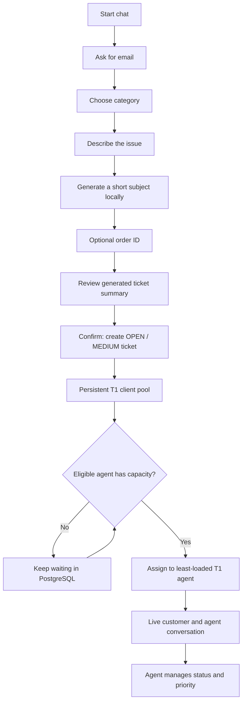

# Guided chat and T1 routing



## Customer intake

`src/components/GuidedIntake.tsx` asks one question at a time and holds the
answers in React state. The header is “Chat with an Agent”, without numbered
steps. Automated prompts render as plain conversation content, with category,
issue, skip, and confirmation buttons inside the thread. The bottom composer
also accepts typed answers, category names/aliases, “skip”, “yes”, and “edit”.
No ticket exists until the customer confirms the review. The optional order
ID remains available to satisfy the assignment. After assignment the live
header changes to the assigned agent's name.

`POST /customer/intake/summary` returns a local extractive subject: normalize
whitespace, remove an introductory greeting, keep the first substantive
sentence, and shorten it to at most 100 characters at a word boundary. This
is deterministic summarization, not an LLM integration. No customer text is
sent to an external AI provider. The full description is preserved as the
first public message.

`POST /customer/tickets` accepts only email, category, description, and optional
order ID. It regenerates the subject server-side and sets OPEN / MEDIUM.
Supplying a subject, status, priority, or assignee is rejected. Ticket number,
summary, email, category, order, status, and priority are shown in the chat's
automatic ticket summary. Customers can read workflow fields but cannot edit
them. Customer replies do not change status or priority.

## Durable queue and eligibility

The pool is the set of unassigned active ticket rows in PostgreSQL, not an
in-memory list of browser connections. A customer can close the browser and
their case remains queued. Queue position follows creation time, then ID.
OPEN, IN_PROGRESS, WAITING_FOR_CUSTOMER, and WAITING_FOR_PROVIDER count as
active work; RESOLVED and CLOSED release capacity.

An automatically eligible agent must be T1, have an unexpired server-side
login session, be accepting chats, and have fewer active cases than their
configured capacity. Default capacity is five, adjustable from 1 to 20 in the
agent workspace. Signing in starts accepting; agents can pause/resume, and
signing out of the last active session stops new assignments. This uses
explicit shift availability and session validity, not typing indicators or
browser-presence tracking. Closing a tab alone does not end the eight-hour
session or automatically pause the agent.

`backend/app/routing.py` routes oldest waiting cases first, choosing the
eligible agent with the lowest active workload. Equal workloads use oldest
last-routing time, then agent ID. A PostgreSQL transaction-level advisory lock
serializes routing, manual assignment changes, and capacity changes across
workers. Concurrent arrivals cannot independently claim the same last slot.
Assignment and its audit event are committed together.

The dispatcher runs during ticket creation, login, and availability changes.
`backend/app/queue_worker.py` also retries every two seconds while FastAPI is
running, so resolving/closing a case frees a slot for a waiting customer.
Restarting FastAPI resumes from SQL rows. A database failure leaves queued
cases intact for retry. No extra Redis or task-queue container is required.

Existing assigned cases remain with their owner when that agent pauses or
signs out. Agents can manually reassign, including to T2 for escalation;
manual assignment is an explicit override and may exceed the automatic
capacity target. Unassigning puts an active case back into the automatic pool.
Categories are recorded, but category-specific skill routing is future work.

## Agent controls and live updates

`src/components/RoutingPanel.tsx` renders the pool size, each agent's workload,
capacity, and accepting state. Its controls call
`PATCH /agents/me/availability`; an agent can change only their own readiness
and capacity. `GET /routing` and `/routing/live` are agent-only.

Customer responses expose only the case's assigned agent name, waiting
position, and routing state. They never expose the agent roster or private
notes. Existing SSE streams deliver queue/assignment changes to both roles
without refresh, alongside the persisted messages.

## Local sample login

The SQL sample accounts are `agent@example.com` (Badi Support) and
`mia@example.com` (Mia Support), both T1. The current local demo password is in
the ignored `.local/agent-credentials.txt`. PostgreSQL stores an Argon2 hash,
not the plaintext password. These are local development accounts.

To reset the sample accounts deliberately, run from PowerShell:

```powershell
Push-Location backend
.venv/Scripts/python.exe -m app.demo_accounts
Pop-Location
```

The helper prompts for a new password, resets only the expected local sample
accounts, revokes their old sessions, and updates the ignored credentials
file. It preserves tickets and refuses a non-local database. Ordinary seeding
does not reset passwords.

## Verification

Backend tests cover generated metadata, forged workflow fields, queue order,
eligibility, capacity, fairness, simultaneous arrivals, assignment audits,
privacy, and agent-only status changes. Browser tests cover guided intake,
the sample login, live chat, private notes, assignment, and a real background
worker assigning a waiting case after another case closes.
