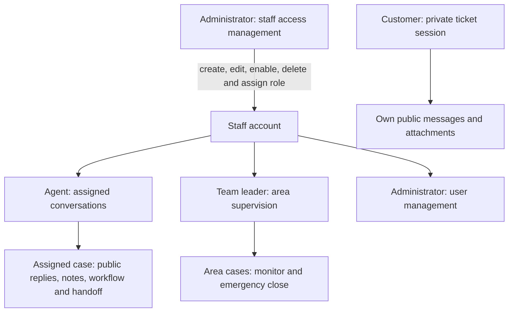

# Badi roles and access

These are separate roles with explicit permissions. Administrator is an access
management role; it does not automatically inherit conversation privileges.
Customers are ticket participants, not staff accounts in the user directory.



| Capability | Customer | Agent | Team leader | Administrator |
| --- | --- | --- | --- | --- |
| Start a support request | Yes, through assistant | No workspace creation control | No | No |
| Read conversations | Own ticket, public content | Own support area; inbox defaults to assigned cases | Own support area, including private notes | No |
| Public replies | Own active ticket | Assigned case | No | No |
| Upload PDF/images | Own active ticket, one file per message, up to 2 MiB | Download permitted case attachments | Download area case attachments | No |
| Internal notes | Never exposed | Assigned case | Read only | No |
| Status and priority | Read only, except End Chat closes own case | Assigned case | Emergency close only | No |
| Transfer / return to queue | No | Assigned active case | No | No |
| Online / Break / Offline | Not applicable | Account menu | Not routed | Not routed |
| Read/create/edit/delete staff | No | No | No | Yes, across support areas |
| Assign roles / reset password / disable | No | No | No | Yes |

## Enforcement and data

`agents` remains the staff-account table, now supporting `AGENT`, `TEAM_LEAD`,
and `ADMIN`, plus `is_active`. It stores name, email, password hash, area, tier,
capacity, and availability. Password hashes are never returned by user APIs.
The UI renders a workspace from the server-provided role after login; the role
cannot be supplied in login requests to elevate access.

`security.py` checks the live database account and opaque, hashed session token
on each protected request. `CurrentOperator`, `CurrentLeader`, `CurrentAdmin`,
and `CurrentSupport` gate endpoints independently of the frontend. SSE loaders
recheck access and terminate when a session is revoked. Customer cookies grant
access only to their ticket's public response allowlist.

Administrator writes take the routing transaction lock. Changing role, area,
tier, email, password, or enabled state revokes the user's sessions, marks the
account Offline, and returns active cases for reassignment. Name-only edits
preserve the login; capacity changes affect routing. The API prevents removing
or disabling the last active administrator. Administrators cannot delete the
account they are currently using.

Deleting a staff account removes its login and sessions. Cases, messages, and
activity history remain; historical assignee links are cleared, while actor
names in existing messages/events remain as written. Disable an account instead
when you want to preserve the profile for later reactivation.

The three fixed roles are a deliberate first RBAC implementation. Administrators
assign them; custom permission bundles and role-definition CRUD are not included.
Support areas scope case access. T1/T2 are routing tiers, not permissions roles;
automatic intake routing currently targets T1 only.

## UI, endpoints, and local testing

- `#/support`: customer assistant and saved conversation.
- `#/agent`: shared staff sign-in; agents and leaders see their appropriate workspace.
- `#/admin`: staff sign-in alias; administrators see `AdminWorkspace.tsx` after authentication.
- `GET/POST /admin/users`: list and create staff.
- `GET/PUT/DELETE /admin/users/{id}`: read, update the complete profile, delete.

Only Administrator can use the user endpoints. The `/admin` URL itself is not
authorization; signing in as an agent still opens the agent workspace.

The first local administrator is `admin@example.com`. Its generated password is
saved only in ignored `.local/admin-credentials.txt`. Existing agent/leader
passwords are unchanged. For a fresh local database, migrate first, then run:

```powershell
$env:PYTHONPATH = 'backend'
backend/.venv/Scripts/python.exe -m app.bootstrap_admin
```

The helper is restricted to the local `badi` database, preserves existing active
administrators, and never silently resets a password. Use separate browser
profiles/private windows to test roles, since tabs share staff cookies.

## Attachments and ending a chat

`ChatThread.tsx` keeps the selected file and unsent text in React memory. The
paperclip validates size/type immediately. Sending with a file uses multipart
`POST /customer/tickets/{id}/attachments`; without a file, the existing JSON
message endpoint is used. The browser supplies the multipart boundary.

FastAPI validates actual image/PDF content and matching extension/MIME. PNG,
JPEG, GIF, WebP and unencrypted PDF are accepted; SVG and other formats are
rejected. Files are limited to 2,097,152 bytes. A separate request-body bound
also protects multipart parsing, including chunked uploads.

One transaction saves the public message and attachment. PostgreSQL `attachments`
stores the bytes and metadata linked to `ticket_messages`; binary data is deferred
and never included in live snapshots. SSE sends only attachment metadata, which
both chat UIs render as download links. Downloads independently check the ticket
session or staff area and use attachment disposition and `nosniff`. Customer
downloads can never read an internal message's attachment.

For this local version the database stores small files. If later traffic requires
object storage, keep the same authorization checks and metadata contract, and
move only the binary payload storage behind the download service.

`End Chat` calls `POST /customer/tickets/{id}/end`, which atomically closes the
case, records the customer disconnection time, adds a dated public chat event
and private status note, and releases routing capacity. Repeated requests are
idempotent. Customer-ended conversations cannot be reopened. The cookie remains
valid for read-only history; refresh preserves the closed view.

Start Over appears inside the conversation footer. It calls `/customer/logout`,
clears React conversation/draft/access-code state, closes its SSE stream, and
returns to a clean assistant with no old ticket, status, queue or agent header.
The existing case remains in PostgreSQL; its private code can restore history.

## Current UI and theme

- The compact Badi Help & Care banner leaves more space for the conversation.
- The customer input has a paperclip inside its left edge and send icon on the
  right. Validation remains PDF/images up to 2 MiB.
- Attachment clicks open an authorized preview dialog. Only Download initiates
  a download. Blob URLs are revoked on close. A lazy-loaded local PDF.js worker
  renders PDF pages to canvas with page controls; PDF scripts and annotations
  are not mounted. Media retains its original colors in dark mode. See
  [the official PDF.js rendering examples](https://mozilla.github.io/pdf.js/examples/index.html).
- Administrator has navigation, a searchable/filterable staff table, ten-row
  pagination, profile dialogs, and a Roles & Permissions view.
- Agent account menus expose availability and sign-out. Administrator controls
  capacity from staff profiles. Forged operator capacity writes return 403,
  without applying accompanying availability changes.
- `ThemeToggle.tsx` stores only the appearance preference in localStorage. The
  system preference supplies the initial default. `theme.css` provides distinct
  surfaces, text, focus, input, case-state and internal-note colors without
  inverting media. The saved theme is applied before the first paint.

## Message activity

The assigned agent's chat acknowledges public customer messages when visible
inside both the conversation viewport and browser window. Background tabs,
offscreen messages and preview dialogs do not acknowledge unseen content.
Receipts persist in SQL and appear as small italic Seen labels. Leaders and
administrators cannot create operator receipts.

Public draft input sends a short typing lease with no draft text. It stops on
inactivity, switching to notes, hiding/leaving the conversation, or expiry. The
server expires typing after six seconds and checks assignment, availability
and session freshness before exposing it to customers.

Each agent has a monotonic ticket read cursor. Active unread cases have a red
count. Awaiting reply uses the earliest customer message after the latest public
human-agent reply. Notes, acknowledgements, assignment and hold/status changes
do not reset that clock. Closed/resolved cases hide active alerts.

See the [security review](security-review-2026-11-10.md) for file hardening,
throttling, response policies and remaining deployment requirements.
